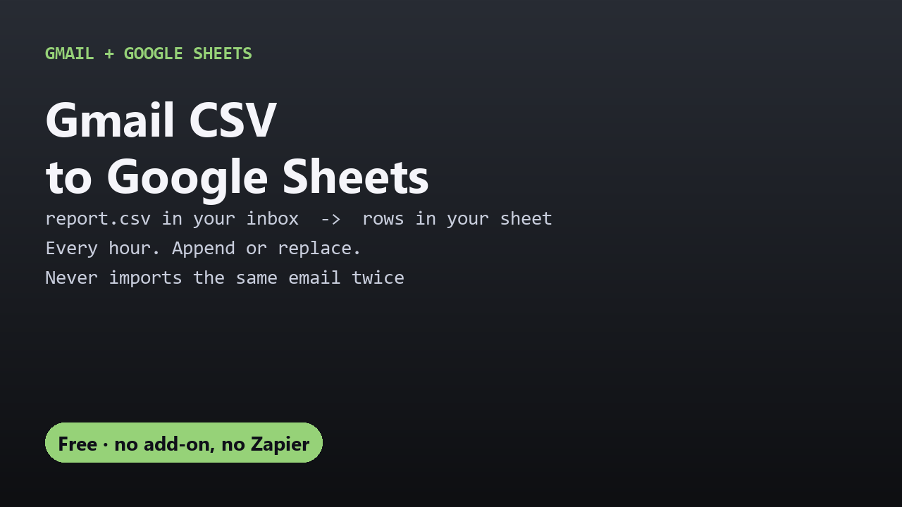

# Free Gmail CSV to Google Sheets import

Import CSV attachments from Gmail into a Google Sheet automatically, every hour, appending or replacing. One free Apps Script file, no add-on.

## Guides

- [How to import CSV attachments from Gmail into Google Sheets automatically](import-csv-from-gmail-to-google-sheets.html)

## Get it

The script and full instructions are on GitHub: [DecodedXR/gmail-csv-to-sheets](https://github.com/DecodedXR/gmail-csv-to-sheets). It's MIT licensed and free.
